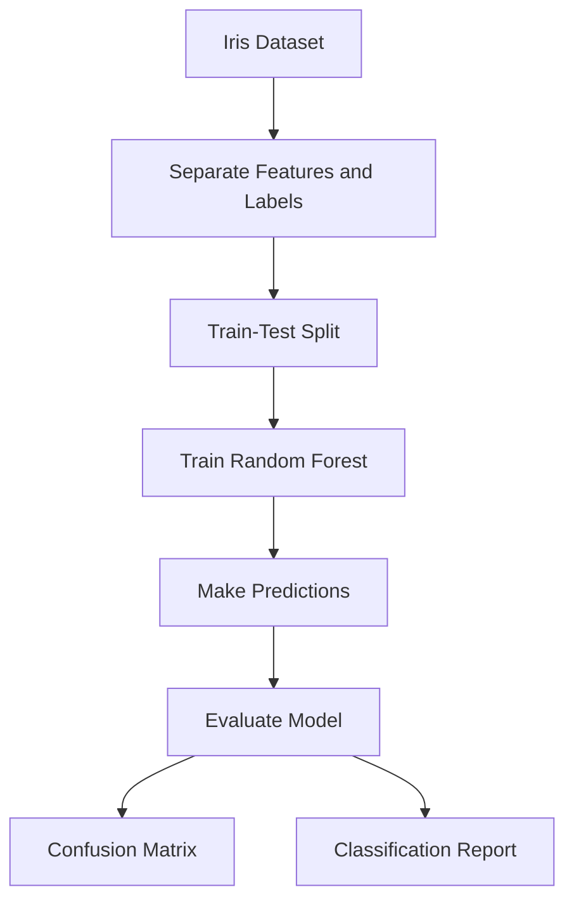

# 🌸 Iris Flower Classification Using Random Forest

<p align="center">
  
  
  
  
</p>

## 📌 Project Overview

This project builds a machine learning classification model using the Random Forest algorithm to predict the species of an Iris flower from its measurements.

It uses Python and Scikit-learn and demonstrates the basic workflow of a supervised machine learning project.

## 🎯 Objectives

* Understand the Random Forest algorithm.
* Train a classification model using the Iris dataset.
* Split data into training and testing sets.
* Evaluate model performance using classification metrics.
* Visualize predictions and feature importance.
* Practice organizing and documenting a machine learning project.

## 📊 Dataset

The project uses Scikit-learn's built-in Iris dataset.

* **Total samples:** 150
* **Input features:** 4
* **Target classes:** 3

### Input Features

| Feature      | Description               |
| ------------ | ------------------------- |
| Sepal length | Length of the sepal in cm |
| Sepal width  | Width of the sepal in cm  |
| Petal length | Length of the petal in cm |
| Petal width  | Width of the petal in cm  |

### Target Classes

* Setosa
* Versicolor
* Virginica

## 🧠 Algorithm: Random Forest

Random Forest is a supervised learning algorithm that combines multiple decision trees to make predictions.

For classification, each tree votes for a class, and the class with the most votes becomes the final prediction.

### Model Configuration

| Parameter       | Value                    |
| --------------- | ------------------------ |
| Algorithm       | Random Forest Classifier |
| Number of trees | 100                      |
| Maximum depth   | None (default)           |
| Random state    | 42                       |
| Test size       | 20%                      |
| Training size   | 80%                      |

## 🔄 Machine Learning Workflow



## 🛠️ Technologies Used

* Python
* Scikit-learn
* Matplotlib
* Git
* GitHub
* Visual Studio Code

## 📁 Project Structure

```text
iris-random-forest/
│
├── images/
│   ├── confusion_matrix.png
│   └── feature_importance.png
│
├── random_forest_iris.py
├── requirements.txt
├── README.md
└── .gitignore
```

## 📈 Model Evaluation

The model is evaluated using the following metrics:

* **Accuracy:** Overall proportion of correct predictions.
* **Precision:** Proportion of predictions for a class that are correct.
* **Recall:** Proportion of actual examples of a class correctly identified.
* **F1-score:** Harmonic mean of precision and recall.
* **Confusion matrix:** Shows correct and incorrect predictions for each class.

### Confusion Matrix


The confusion matrix helps identify which flower species the model predicts correctly and which classes it confuses.

### Feature Importance


The feature importance chart shows the relative contribution of each feature to the trained Random Forest's splitting decisions.

### Results

Run the Python script to obtain the actual evaluation results. Record the measured accuracy and other metrics here after running the project.

**Accuracy:** Add the actual accuracy printed by your program.

Do not enter a guessed score. Evaluation results depend on the data split and model configuration.

## ⚙️ Installation and Setup

### 1. Clone the repository

```bash
git clone YOUR_GITHUB_REPOSITORY_URL
cd iris-random-forest
```

Replace the example URL with the URL of your GitHub repository.

### 2. Create a virtual environment

For Windows:

```powershell
python -m venv .venv
```

Activate it:

```powershell
.\.venv\Scripts\Activate.ps1
```

### 3. Install dependencies

```bash
python -m pip install -r requirements.txt
```

### 4. Run the project

```bash
python random_forest_iris.py
```

The script prints the model's accuracy, classification report, confusion matrix, and a sample prediction.

## 🔮 Example Prediction

The model predicts a flower species from four measurements:

```python
sample = [[5.1, 3.5, 1.4, 0.2]]
```

The feature order is sepal length, sepal width, petal length, and petal width.

## 📚 Key Learnings

* Loading a dataset with Scikit-learn.
* Separating input features and target labels.
* Splitting data into training and testing sets.
* Training a Random Forest classifier.
* Evaluating classification performance.
* Generating and saving plots with Matplotlib.
* Documenting a machine learning project for GitHub.

## 🚀 Future Improvements

* Compare Random Forest with Logistic Regression, KNN, SVM, and Decision Tree.
* Perform hyperparameter tuning using cross-validation.
* Add automated tests.
* Build a simple web application for predictions.
* Experiment with additional classification datasets.

## 👨‍💻 Author

Created as a hands-on machine learning project to practice supervised classification with Python and Scikit-learn.

## 📄 License

A license can be added to specify how others may use, modify, and distribute this project.
